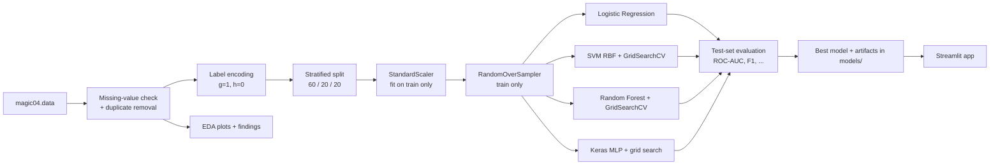
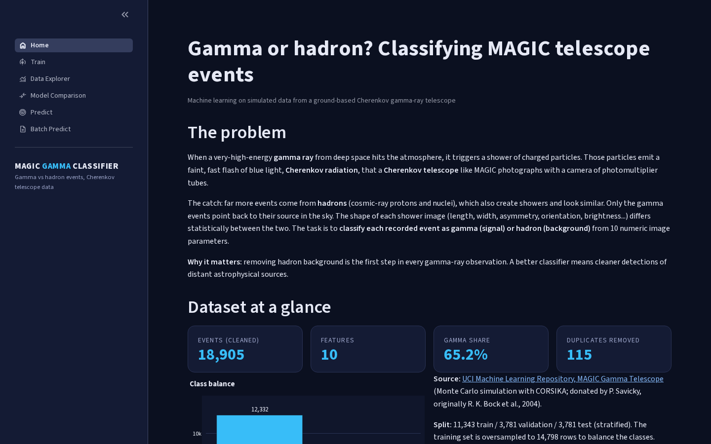
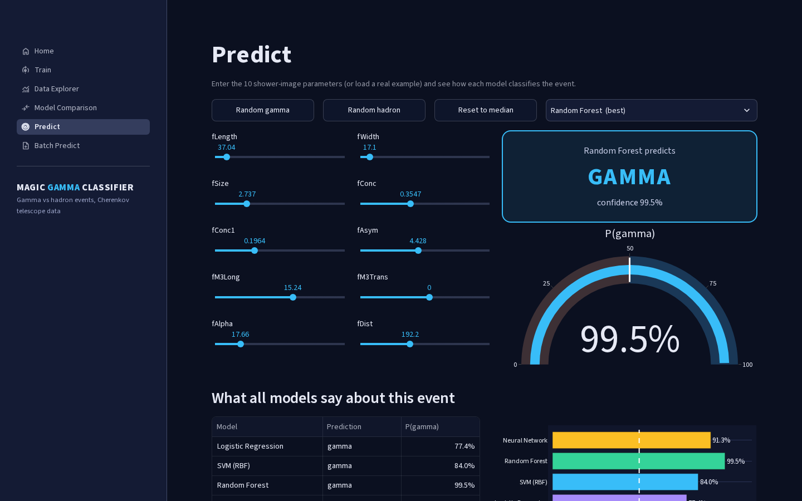
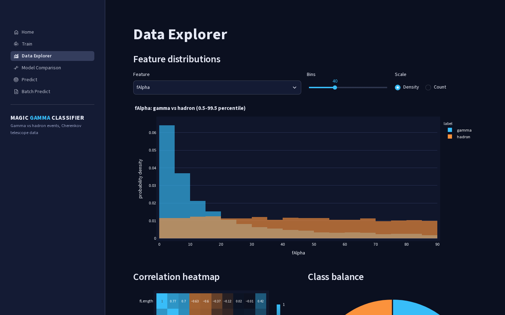
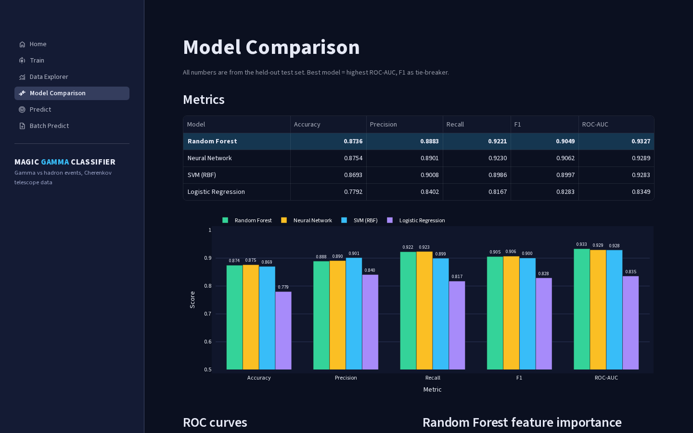
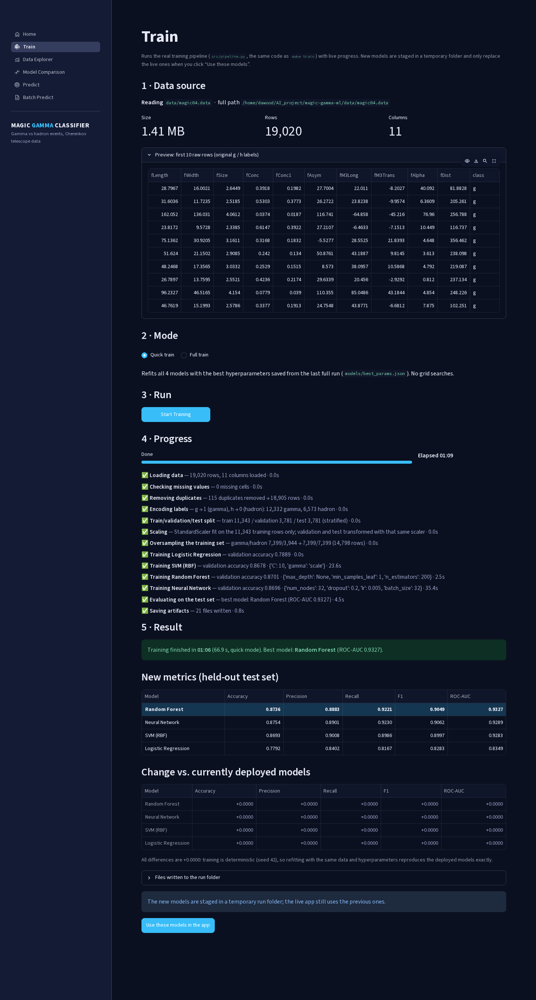
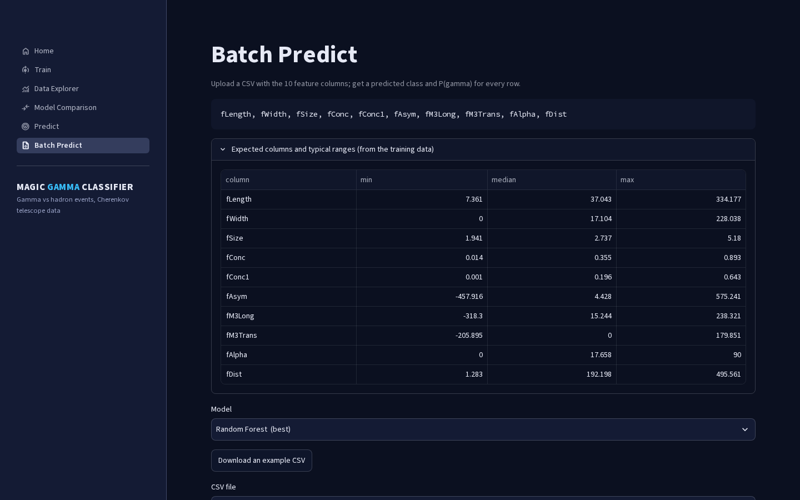

# MAGIC Gamma Telescope Classification

Classify events from a ground-based Cherenkov gamma-ray telescope as **gamma** (signal) or **hadron** (background), compare four machine-learning models, and try them in an interactive Streamlit app.

**Live demo:** _<add Streamlit Community Cloud URL here>_

## Problem

When a high-energy gamma ray hits the atmosphere it triggers a particle shower that emits Cherenkov light, which the MAGIC telescope photographs. Cosmic-ray **hadrons** produce similar-looking showers and vastly outnumber gammas, but only gamma events point back to their astronomical source. Given 10 numeric shower-image (Hillas) parameters, the task is to classify each event as gamma or hadron, a first step in every gamma-ray analysis.

## Dataset

[UCI MAGIC Gamma Telescope dataset](https://archive.ics.uci.edu/dataset/159/magic+gamma+telescope): Monte Carlo (CORSIKA) simulated events, donated by P. Savicky, originally from R. K. Bock et al. (2004). 19,020 rows, 10 features (`fLength, fWidth, fSize, fConc, fConc1, fAsym, fM3Long, fM3Trans, fAlpha, fDist`) and a class label (`g`/`h`). Details: `data/magic04.names`.

## Pipeline



Preprocessing results on this dataset: 0 missing cells, 115 exact duplicate rows removed (19,020 -> 18,905), split 11,343 train / 3,781 validation / 3,781 test; the training set is oversampled to 14,798 rows. The scaler is fit on the training set only and saved to `models/scaler.joblib`.

## Models and results

Four models, `random_state=42` throughout. SVM and Random Forest are tuned with 5-fold `GridSearchCV` (scored by ROC-AUC, with oversampling applied *inside* each fold). The MLP uses a 16-combination grid search with early stopping on the real validation set. A prediction is "gamma" when P(gamma) >= 0.5.

Held-out test set (3,781 events), produced by `python -m src.main`:

| Model | Accuracy | Precision | Recall | F1 | ROC-AUC |
|---|---|---|---|---|---|
| **Random Forest** | 0.8736 | 0.8883 | 0.9221 | 0.9049 | **0.9327** |
| Neural Network | 0.8754 | 0.8901 | 0.9230 | 0.9062 | 0.9289 |
| SVM (RBF) | 0.8693 | 0.9008 | 0.8986 | 0.8997 | 0.9283 |
| Logistic Regression | 0.7792 | 0.8402 | 0.8167 | 0.8283 | 0.8349 |

**Best model: Random Forest**, chosen by highest ROC-AUC (F1 as tie-breaker). The top three are close (0.0038 AUC between first and second), while the linear baseline is clearly worse, so the class boundary is non-linear. Full write-up: [`outputs/results/comparison.md`](outputs/results/comparison.md). EDA observations: [`outputs/eda/findings.md`](outputs/eda/findings.md).

Outputs: `outputs/eda/` (class balance, histograms, correlation heatmap, box plots, pair plot) and `outputs/results/` (`results.csv`, ROC curves, metric bars, confusion matrices, RF feature importance, NN training history).

## Project structure

```
src/            config, preprocessing, split_scale, eda, models (4), evaluate, inference, main
app/            Streamlit app (streamlit_app.py + views/ + utils.py)
models/         trained artifacts (scaler, 4 models, best_model.*, metadata)
outputs/        eda/ and results/
data/           magic04.data
.streamlit/     theme
Makefile        make train | make app | make all
```

## How to run

Python 3.12 is recommended (TensorFlow does not yet support 3.14).

```bash
python -m venv .venv && source .venv/bin/activate
pip install -r requirements.txt

# 1. Train everything (clean, EDA, tune, evaluate, save artifacts) - a few minutes on CPU
python -m src.main            # or: make train   (--mode quick reuses saved hyperparameters; --skip-eda skips the plots)

# 2. Launch the app (loads saved artifacts, never retrains)
streamlit run app/streamlit_app.py   # or: make app
```

TensorFlow is forced to CPU (`CUDA_VISIBLE_DEVICES=-1`).

## Train page (retrain from the UI)

The **Train** page runs the *real* pipeline (`src/pipeline.py::run_pipeline`, the same function `make train` calls: there is one code path) with live progress:

- **Data source panel:** file path, size, row/column count and a preview of the first 10 raw rows (original `g`/`h` labels).
- **Quick train:** refits all 4 models with the hyperparameters saved by the last full run (`models/best_params.json`). About a minute on CPU (measured: 53-67 s).
- **Full train:** every grid search (SVM, Random Forest, 16 neural-network combinations). A few minutes (measured: about 5 min in the terminal, about 7 min through the browser UI on the same machine).
- **Live progress:** each of the 13 pipeline steps shows a check mark with its real numbers (rows loaded, duplicates removed, class counts before/after oversampling, per-model time and validation accuracy), a per-epoch loss/accuracy chart for the neural network, the grid-search combination counter in Full mode, and elapsed time.
- **Safe by design:** training happens in a background thread and writes to a temporary run folder (`models/runs/<timestamp>/`). Live models are only replaced when you click **Use these models in the app** (which also refreshes the app's caches). Failed or cancelled runs leave `models/` untouched. A **Cancel** button stops at the next epoch/step boundary.
- When it finishes you get the new test metrics and the change versus the currently deployed models. Because training is seeded, a Quick run on unchanged data reproduces the deployed metrics exactly (all differences +0.0000).
- If TensorFlow is unavailable the Neural Network step is skipped with a visible note (such a run can be inspected but not deployed). On Streamlit Community Cloud, Full mode shows a resource warning.

## Run with Docker (everything in one container)

```bash
docker compose up -d --build     # or: make docker-up
# open http://localhost:8501
docker compose down              # stop
```

The image (Python 3.12 + all pinned dependencies + the trained models) starts the Streamlit app directly. If `models/` is ever empty, the container trains first and then starts the app. The first build takes several minutes (TensorFlow); later builds reuse the cached layers.

## Web app

Pages: **Home** (problem + dataset cards), **Train** (retrain the models from the browser, live progress), **Data Explorer** (interactive Plotly charts), **Model Comparison** (metrics, ROC, confusion matrices, feature importance), **Predict** (sliders, random gamma/hadron example, model selector, probability gauge, all-4-model comparison) and **Batch Predict** (CSV upload and download).

| Home | Predict |
|---|---|
|  |  |
| **Data Explorer** | **Model Comparison** |
|  |  |
| **Train** | **Batch Predict** |
|  |  |

Full-length page captures are in `docs/screenshots/` (`home.png`, `explorer.png`, ...). Regenerate them with `python scripts/screenshots.py` (needs `pip install -r requirements-dev.txt` and `playwright install chromium`).

## Deploying to Streamlit Community Cloud

1. Push the repo to GitHub, including `models/` and `outputs/` (all artifacts are well under 50 MB; the largest are the Random Forest and best-model copies, ~8 MB each).
2. On share.streamlit.io create an app with main file `app/streamlit_app.py`, and under *Advanced settings* choose **Python 3.12**.
3. Dependencies come from `requirements.txt` (pinned; TensorFlow is the CPU build). No `runtime.txt` is used by Community Cloud.

If the app runs out of memory on the free tier, TensorFlow is the likely cause (it is only imported when the Neural Network is loaded).

## Credits

Data: Bock, R.K. et al. (2004), *Methods for multidimensional event classification: a case study using images from a Cherenkov gamma-ray telescope*, Nucl. Instr. Meth. A 516, 511-528.
